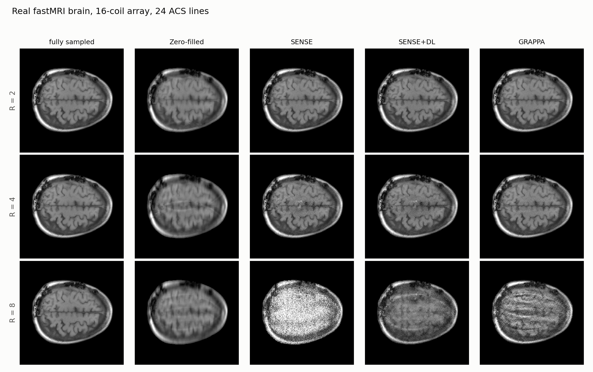
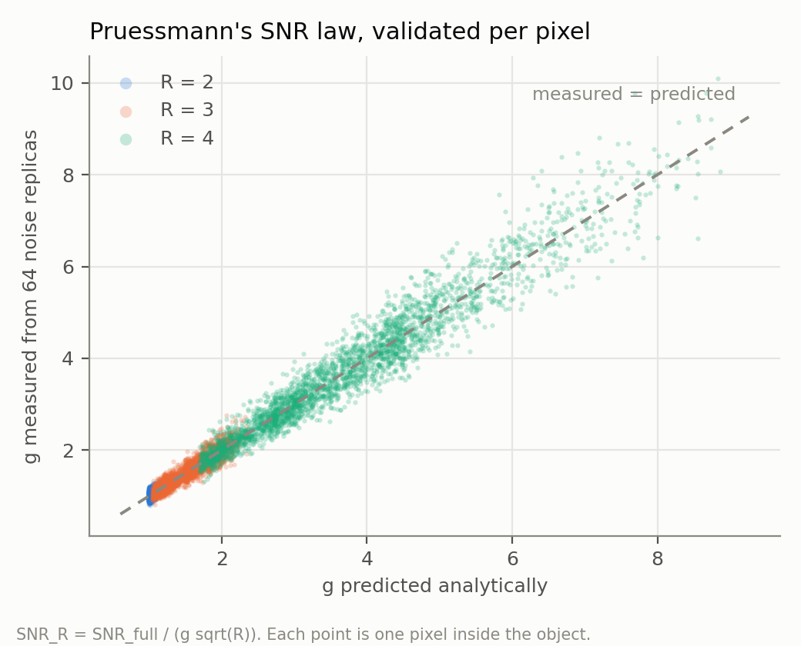
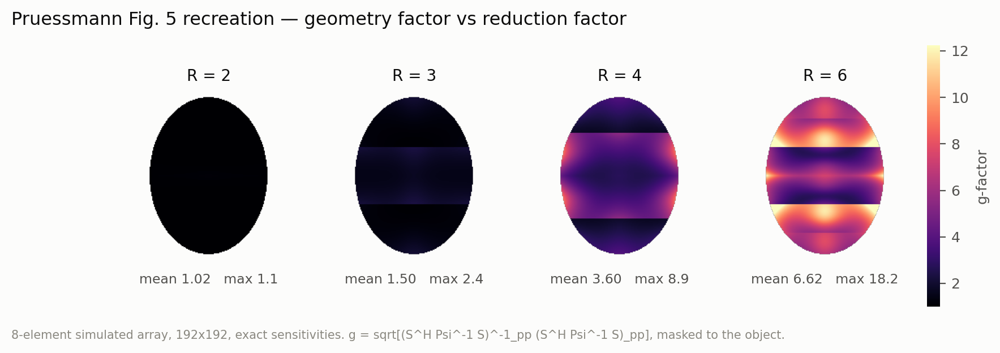
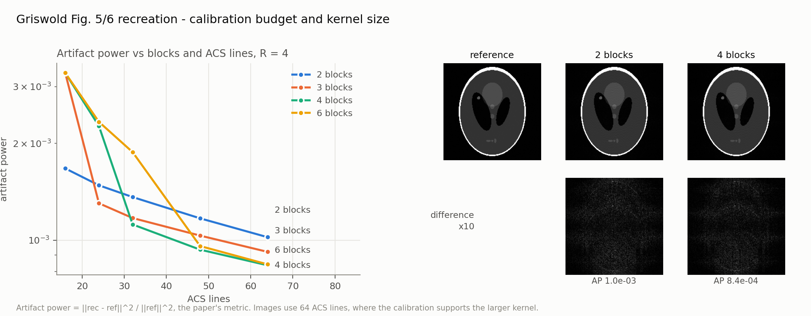
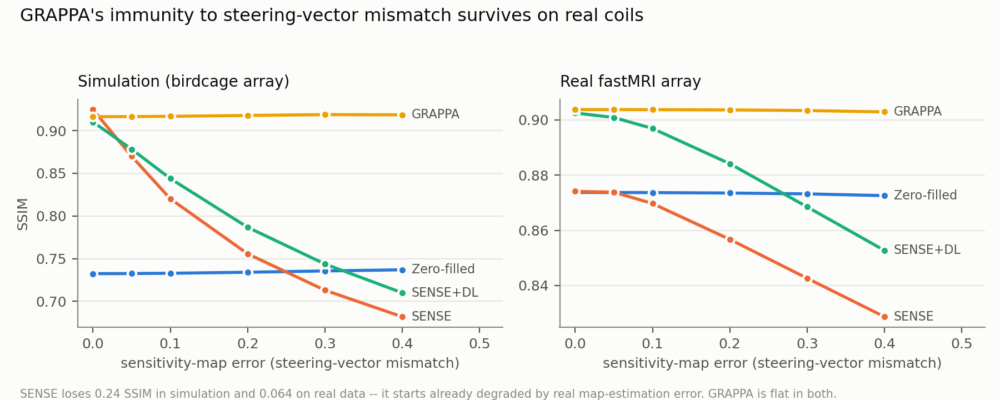

<div align="center">

# Receiver-Coil Arrays as Sensor Arrays

**SENSE and GRAPPA, reproduced from the original papers and analysed as array signal processing**




<sub>Real fastMRI brain slice, 16-coil array, 24 ACS lines. Columns: fully sampled, zero-filled, SENSE, SENSE with diagonal loading, GRAPPA. Rows: acceleration R = 2, 4, 8.</sub>

</div>

---

## Overview

Parallel MRI skips a factor *R* of the k-space lines and recovers the image from the spatial
diversity of the receiver-coil array. Its two founding methods are

- **SENSE**: K. P. Pruessmann *et al.*, "SENSE: Sensitivity encoding for fast MRI," *Magn. Reson. Med.* 42(5):952–962, 1999.
- **GRAPPA**: M. A. Griswold *et al.*, "Generalized autocalibrating partially parallel acquisitions (GRAPPA)," *Magn. Reson. Med.* 47(6):1202–1210, 2002.

We implement both **from the papers, without a reconstruction library**, reproduce each paper's central
quantitative claim, and then test whether reading the coil array as a sensor array predicts how each
method fails.

| Array processing | Parallel MRI |
|---|---|
| Steering vector **a**(θ) | Coil sensitivities **s**(**r**) at one pixel |
| Noise covariance **R**ₙ | Coil noise covariance Ψ |
| Array / white-noise gain | g-factor |
| Steering-vector mismatch | Sensitivity-map error |
| Snapshot budget | Autocalibration (ACS) lines |
| Model-order selection (MDL) | Rank of the calibration matrix |

## Key results

| Test | Result | Verdict |
|---|---|---|
| Pruessmann SNR law, measured / predicted g (white R=2, white R=4, correlated Ψ R=4) | 1.0000 · 0.9997 · 0.9996 | ✅ reproduced |
| Griswold convergence with kernel and ACS size | error 2.3e-2 → 5.5e-2 *(bug)*, then ≈ 9e-3 and falling after the fix | ✅ reproduced, found a bug |
| Assuming white coil noise, mean g at R=4 | 3.68 vs 4.54 with measured Ψ | ⚠️ 23 % under-predicted |
| Sensitivity-map error 0 → 40 % | SENSE drops, GRAPPA flat | complementary failures |
| ACS 96 → 12 lines | ranking reverses | complementary failures |
| Diagonal loading, worst-case robust SENSE, MDL/AIC | each < 0.005 SSIM | ❌ do not transfer |
| Per-pixel correlation of the g-map | r = 0.973 with noise, r = 0.197 with error | g is a noise gain |
| Ψ from 3.2 noise samples per coil | sample cov. −0.0086 SSIM, Ledoit–Wolf +0.0011 | shrink before inverting |

Full numbers, protocols and the negative results are in [`README_ARRAY.md`](README_ARRAY.md).

## Figures

<table>
<tr>
<td width="50%"><br>
<sub><b>SNR law, per pixel.</b> Analytic g against g measured from noise replicas; points lie on the identity line at R = 2, 3, 4.</sub></td>
<td width="50%"><br>
<sub><b>Pruessmann Fig. 5 recreation.</b> g-factor maps of a simulated 8-element array for R = 2 to 6.</sub></td>
</tr>
<tr>
<td><br>
<sub><b>Griswold Fig. 5/6 recreation.</b> Artifact power falls with ACS lines and kernel blocks at R = 4.</sub></td>
<td><br>
<sub><b>Steering-vector mismatch.</b> SENSE degrades with sensitivity-map error; GRAPPA, which never forms a map, stays flat in simulation and on real coils.</sub></td>
</tr>
</table>

More: [`paper_P0_aliasing`](figures/paper_P0_aliasing.png) · [`paper_P2_sense_vs_R`](figures/paper_P2_sense_vs_R.png) · [`paper_G1_kernel`](figures/paper_G1_kernel.png)

## Repository layout

```
.
├── src/
│   ├── recon.py            # zero-filled, SENSE (+Ψ, diagonal loading, worst-case robust), GRAPPA, ESPIRiT
│   ├── simulate.py         # forward model, phantom, coil maps, sampling masks
│   ├── fastmri_data.py     # fastMRI loader, noise covariance, pre-whitening, body mask
│   ├── metrics.py          # NMSE, PSNR, SSIM
│   ├── array_cov.py        # sample vs shrinkage noise covariance
│   ├── coil_select.py      # sensor (coil) selection
│   ├── stats.py            # bootstrap confidence intervals, Holm control
│   └── ...
├── validate_snr_law.py     # replication of both papers' quantitative claims
├── test_espirit.py         # ESPIRiT correctness guards
├── make_paper_figures.py   # recreated figures from both papers
├── experiments.py          # seeded simulation sweeps
├── run_*.py                # fastMRI experiments (one script per study)
├── results/                # CSV outputs of every run
├── figures/                # generated figures
├── README_ARRAY.md         # full write-up: methods, results, dead ends
└── ARRAY_SIGNAL_PROCESSING_HANDOFF.md   # working log
```

## Quick start

```bash
git clone https://github.com/JPL11/coil-arrays-as-sensor-arrays.git
cd coil-arrays-as-sensor-arrays
pip install -r requirements.txt

python validate_snr_law.py     # SNR-law and GRAPPA replication (simulation, no data needed)
python test_espirit.py         # ESPIRiT guards
python make_paper_figures.py   # regenerates figures/paper_*.png
```

The fastMRI scripts (`run_fastmri.py`, `run_effective_g.py`, ...) expect multicoil data under
`../datasets/fastmri/multicoil_val`. fastMRI is not redistributed here; request access at
<https://fastmri.med.nyu.edu>.

## Verifying the results

| Claim | Where to look |
|---|---|
| SENSE unfolding and g-factor (Pruessmann) | `src/recon.py`: `sense_recon(..., Psi=, return_gfactor=True)`, `sense_robust` |
| GRAPPA kernel fit and the border fix (Griswold) | `src/recon.py`: `grappa_recon` |
| SNR law to 0.04 % | `validate_snr_law.py` |
| Internal checks (round trip, exact recovery, Parseval) | `README_ARRAY.md` → *Verification status* |
| Map mismatch, ACS starvation, aperture | `run_fastmri.py`, `run_aperture_fixed.py` → `results/fastmri_*.csv` |
| MDL/AIC failure | `run_model_order.py` → `results/model_order.csv` |
| g predicts noise, not error | `run_effective_g.py`, `analyze_effective_g.py` → `results/effective_g*.csv` |
| Covariance shrinkage | `run_noise_cov.py` → `results/noise_cov.csv` |
| Coil selection (after audit) | `run_coil_select.py` → `results/coil_select_bias_recovery_R4K5_summary.csv` |

Not included: raw data, pretrained model weights, and `results/resolution_psf.csv` (25 MB), which
`run_resolution_psf.py` regenerates. `torch` and `fastmri` are needed only for `src/learned_recon.py`.

## References

1. K. P. Pruessmann, M. Weiger, M. B. Scheidegger, P. Boesiger, "SENSE: Sensitivity encoding for fast MRI," *MRM* 42(5), 1999.
2. M. A. Griswold *et al.*, "Generalized autocalibrating partially parallel acquisitions (GRAPPA)," *MRM* 47(6), 2002.
3. P. M. Robson *et al.*, "Comprehensive quantification of signal-to-noise ratio and g-factor for image-based and k-space-based parallel imaging reconstructions," *MRM* 60(4), 2008.
4. M. Wax, T. Kailath, "Detection of signals by information theoretic criteria," *IEEE Trans. ASSP* 33(2), 1985.
5. S. A. Vorobyov, A. B. Gershman, Z.-Q. Luo, "Robust adaptive beamforming using worst-case performance optimization," *IEEE Trans. Signal Process.* 51(2), 2003.
6. M. Uecker *et al.*, "ESPIRiT: An eigenvalue approach to autocalibrating parallel MRI," *MRM* 71(3), 2014.
7. O. Ledoit, M. Wolf, "A well-conditioned estimator for large-dimensional covariance matrices," *J. Multivariate Anal.* 88(2), 2004.
8. J. Zbontar *et al.*, "fastMRI: An open dataset and benchmarks for accelerated MRI," arXiv:1811.08839, 2018.
